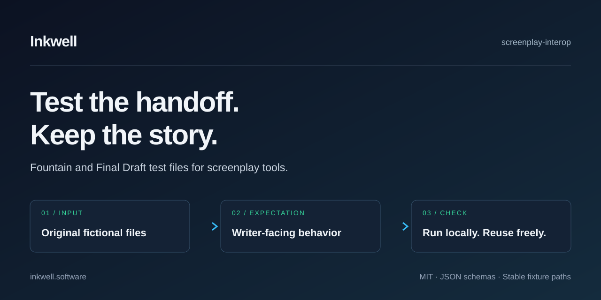

<p align="center">
  <a href="https://www.inkwell.software/resources/interop?utm_source=github&amp;utm_medium=referral&amp;utm_campaign=screenplay_interop&amp;utm_content=hero_interop_guide&amp;utm_id=github_screenplay_interop&amp;utm_source_platform=github">
    
  </a>
</p>

# screenplay-interop

**Test how screenplay files travel between tools.** Sixteen original fictional
Fountain 1.1 and Final Draft (FDX) files cover dialogue, formatting, revision
marks, locked pages, and other details writers need to keep.

[](https://github.com/inkwell-app/screenplay-interop/actions/workflows/ci.yml)
[](./LICENSE)
[](#install-and-run)

**[Browse the cases](#fixture-catalog)** · **[Read the expectations](docs/compatibility.md)** · **[Add a case](CONTRIBUTING.md)**

## What this is

A fixture suite for developers building screenplay parsers, importers, diff
tools, and format converters. Each case pairs a small input file with expected
behavior and a short explanation of why it matters to a writer. Use the same
files in your own tests to compare results and reproduce an import problem.

The included runner validates the fixture files and their expectation schemas,
checks XML syntax for FDX cases marked readable, then generates the
[case catalog](docs/compatibility.md). Intentionally malformed inputs remain
available for testing error handling. To test an application,
run its import or export on a case and compare the result with `expected.json`.

For a quick look at your own `.fdx` file, open Inkwell's
[FDX Inspector](https://www.inkwell.software/tools/fdx-inspector?utm_source=github&utm_medium=referral&utm_campaign=screenplay_interop&utm_content=readme_fdx_inspector&utm_id=github_screenplay_interop&utm_source_platform=github)
in your browser. It shows revision sets, page markers, scene numbers, and other
production details. The file stays in the tab.

## Install and run

Requires Node 22.18 or later and pnpm 10.20.0.

```bash
git clone https://github.com/inkwell-app/screenplay-interop.git
cd screenplay-interop
corepack enable
corepack prepare pnpm@10.20.0 --activate
pnpm install --frozen-lockfile
pnpm test
```

`pnpm test` checks the fixtures, runs the validator's tests, and regenerates
`docs/compatibility.md`. Run `pnpm typecheck` to check the runner's TypeScript
and `pnpm smoke:package` to verify the files available to package consumers.

## Try a case

Start with [`fdx-locked-pages`](fixtures/fdx-locked-pages/README.md):

1. Read the case's explanation and `expected.json`.
2. Import `input.fdx` into the tool you are testing.
3. Compare the imported page markers with the input. Export again to check the
   round trip.
4. Record the tool version, fixture commit, and observed result with your test.

Stable paths make cases easy to pin in a test suite:

```text
fixtures/fdx-locked-pages/
  README.md        Why the page markers matter
  input.fdx        The original fictional input
  expected.json    Expected behavior and portability classes
  copyright.md     Fixture authorship and license
```

## Fixture catalog

| Case | Format | What to check |
|---|---|---|
| [Core elements](fixtures/fountain-1-1-core/) | Fountain | Heading, action, character, dialogue, parenthetical, transition |
| [Title page](fixtures/fountain-title-page/) | Fountain | Title-page keys stay metadata |
| [Dual dialogue](fixtures/fountain-dual-dialogue/) | Fountain | Two speakers retain their separate dialogue |
| [Forced elements](fixtures/fountain-forced-elements/) | Fountain | Forced character and scene heading retain their types |
| [Notes and sections](fixtures/fountain-notes-sections-boneyard/) | Fountain | Notes, sections, synopses, and boneyard text retain their roles |
| [Unicode](fixtures/fountain-unicode/) | Fountain | Non-ASCII names and punctuation survive |
| [Centered text and breaks](fixtures/fountain-centered-page-breaks/) | Fountain | Centered text and page-break markers retain their formatting |
| [Revision sets](fixtures/fdx-revision-sets/) | FDX | Revision sets, colors, and marked text remain identifiable |
| [Locked pages](fixtures/fdx-locked-pages/) | FDX | Locked page markers remain identifiable |
| [A/B pages](fixtures/fdx-ab-pages/) | FDX | Inserted page labels retain their suffixes |
| [Scene numbers](fixtures/fdx-scene-numbers/) | FDX | Scene headings keep their numbers |
| [Omitted scenes](fixtures/fdx-omitted-scenes/) | FDX | Omitted scenes remain marked |
| [Custom styles](fixtures/fdx-custom-styles/) | FDX | Custom paragraph types can be identified |
| [Malformed input](fixtures/fdx-malformed-recoverable/) | FDX | Damaged XML produces a useful error or warning |
| [Missing revision set](fixtures/fdx-missing-revision-set/) | FDX | A mark referring to a missing set is reported |
| [Name variants](fixtures/fdx-name-variants/) | FDX | Related character cues can be compared |

Fixture IDs are stable. Changes to a case are recorded in [CHANGELOG.md](CHANGELOG.md).

## Portability classes

Each expectation describes how a feature may transfer. Use these classes when
recording your tool's result; the generated catalog lists the fixture expectations.

| Class | Writer consequence |
|---|---|
| `expected_to_transfer` | The behavior survives in the target tool |
| `transfers_with_visible_difference` | The words survive; the page looks different |
| `preserved_as_data_with_changed_controls` | The data remains; the controls differ |
| `likely_lossy` | Production state or text may be lost |
| `unknown` | The behavior needs further investigation |

## File health (FDX inputs)

| Status | Meaning |
|---|---|
| `readable` | The expected input can be read without structural warnings |
| `readable_with_warnings` | The input has a condition worth reporting |
| `malformed` | XML or the required Final Draft structure is broken |
| `unsupported_container` | The input uses a different container format |

## How to add a fixture

Open an [interop issue](https://github.com/inkwell-app/screenplay-interop/issues/new?template=interop.yml)
with the behavior you want to test, or submit a small original-fiction case.
The [contribution guide](CONTRIBUTING.md) covers the files, schema, and checks.

## Copyright rules

Write original text for each case and include its authorship statement in
`copyright.md`. Use invented characters, settings, and dialogue. Keep produced
or published screenplays and private drafts out of issues and pull requests.

## Related work

- [Fountain specification](https://fountain.io/) and [reference implementation](https://github.com/nyousefi/Fountain)
- [Fountain.js](https://github.com/mattdaly/Fountain.js) — JavaScript parser
- [afterwriting](https://github.com/ifrost/afterwriting-labs) — Fountain tools
- [ScreenJSON](https://github.com/screenjson/screenjson-schema) — screenplay interchange schema
- [Trelby](https://github.com/trelby/trelby) and [Story Architect](https://github.com/story-apps/starc) — screenplay editors

## Inkwell

[Inkwell](https://www.inkwell.software/?utm_source=github&utm_medium=referral&utm_campaign=screenplay_interop&utm_content=footer_start_writing&utm_id=github_screenplay_interop&utm_source_platform=github)
is the AI-native writing platform built on structured data, version control,
and agentic skills. Write in Plot, compare drafts, and review AI edits alongside
your screenplay.

Explore the [interoperability guide](https://www.inkwell.software/resources/interop?utm_source=github&utm_medium=referral&utm_campaign=screenplay_interop&utm_content=footer_interop_guide&utm_id=github_screenplay_interop&utm_source_platform=github),
[FDX Inspector](https://www.inkwell.software/tools/fdx-inspector?utm_source=github&utm_medium=referral&utm_campaign=screenplay_interop&utm_content=related_fdx_inspector&utm_id=github_screenplay_interop&utm_source_platform=github),
[Fountain validator](https://www.inkwell.software/tools/fountain-validator?utm_source=github&utm_medium=referral&utm_campaign=screenplay_interop&utm_content=related_fountain_validator&utm_id=github_screenplay_interop&utm_source_platform=github),
and [Screenplay Diff](https://www.inkwell.software/tools/screenplay-diff?utm_source=github&utm_medium=referral&utm_campaign=screenplay_interop&utm_content=footer_screenplay_diff&utm_id=github_screenplay_interop&utm_source_platform=github).

## License

[MIT](LICENSE) for the runner, schemas, and original fictional fixtures.
See [CITATION.cff](CITATION.cff) to cite the collection.
